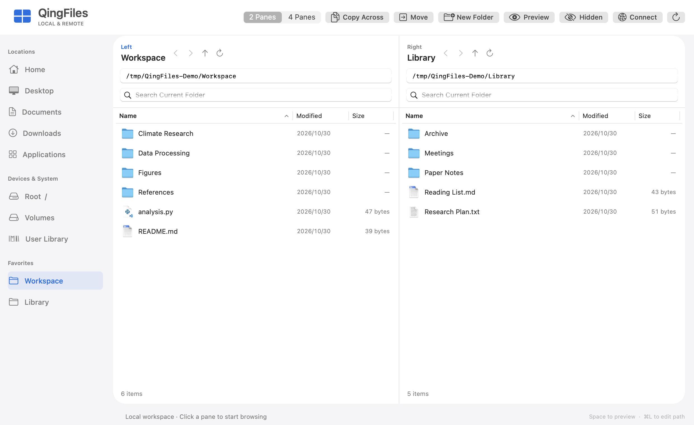
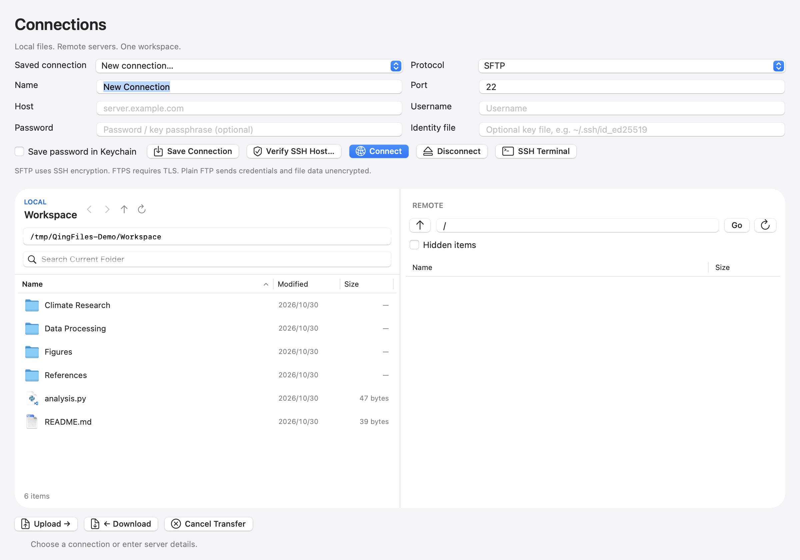

# QingFiles

A free, native multi-pane file manager for macOS, built with Swift and AppKit.

QingFiles puts local folders side by side so you can browse the filesystem, see hidden files, preview documents, and copy or move items between locations. The interface, built-in messages, and project documentation are in English. File names retain their original language; errors supplied by macOS may follow your system language.

**Status:** early native file manager with a local workspace and an FTP/FTPS/SFTP connection workspace. This is an independent implementation, inspired by the general idea of multi-pane file management. It is not affiliated with QSpace.



## Download and launch

Download the ZIP for your Mac from [Releases](https://github.com/THUdzy51/QingFiles/releases), extract it, and open `QingFiles.app`. Optionally drag the app into Applications and keep it in the Dock.

- macOS 13 or later.
- `arm64`: Apple silicon, including M-series Macs.
- `x86_64`: Intel Macs. The build script supports this target; consult each release for which binaries were actually built and tested.
- Releases are ad-hoc signed, not Apple Developer ID signed or notarized. Gatekeeper may require you to explicitly allow a downloaded build. See [Troubleshooting](docs/USER_GUIDE.md#troubleshooting).
- No QingFiles account, subscription, runtime package manager, or telemetry. Files are transferred only to servers you connect to.

## What it does

| Feature | Behavior |
|---|---|
| Remote connections | FTP, explicit FTPS, SFTP uploads/downloads, saved profiles, optional Keychain passwords, and an SSH Terminal launcher. |
| Two or four panes | Each pane has its own folder, navigation history, search, and selection. |
| Direct path entry | Press `⌘L`, enter `/`, `~/Documents`, or another path, and press Return. |
| Filesystem access | Sidebar shortcuts include Home, Root `/`, Volumes, Applications, and User Library. |
| Hidden items | Toggle dotfiles and hidden-flag items with `⌘⇧.`. |
| Search and sorting | Filter names in the current folder; sort by name, modified date, or size. Folders stay first. |
| Quick Look | Select a file and press Space for the system preview. |
| File operations | Copy, cut, paste, copy/move across panes, create folders, rename, and move to Trash. |
| Favorites | Save frequently used folders; right-click a custom favorite to remove it. |
| Persistent workspace | Remember pane locations, hidden-item visibility, and layout between launches. |

The blue pane caption and native keyboard focus identify the active pane. Sidebar navigation changes that pane. In four-pane mode, top-left pairs with top-right; bottom-left pairs with bottom-right. **Copy Across** and **Move** in the main window use the paired pane's current folder as their destination.

## Remote connections



Click **Connect** (or `⌘⇧K`) to open a local/remote workspace. Choose SFTP, FTPS, or FTP; enter a host, username, port, and remote path. For SSH/SFTP, verify the server fingerprint before trusting it. Select regular files and use Upload/Download. **SSH Terminal** opens a shell session in macOS Terminal.

Read the [remote connection guide](docs/REMOTE_CONNECTIONS.md) for authentication, Keychain storage, host verification, cancellation, protocol limits, and partial-upload behavior. No real server credentials are included in this repository.

## File-operation behavior

Read this before using QingFiles for important files:

- Existing destination names are **skipped and reported**. The app does not overwrite files or merge folders.
- Trash requires confirmation and uses the macOS Trash. Restore items through Finder.
- Folder transfers into themselves or their descendants are rejected, including paths through symbolic links.
- Duplicate selections and overlapping parent/child selections are rejected.
- Batch operations may partially succeed. The result reports successes and failures.
- A failed transfer can leave a partial destination. The app does not automatically delete it.
- There is no application-level undo, transfer cancellation, or percentage progress indicator yet.
- On case-insensitive filesystems, a rename that only changes letter case is conservatively rejected as a collision.

The app runs with your current user permissions. It does not elevate privileges or bypass macOS access controls.

## Build from source

Install Apple's Command Line Tools if needed:

```sh
xcode-select --install
```

Then clone and build:

```sh
git clone https://github.com/THUdzy51/QingFiles.git
cd QingFiles
./test.sh
./build.sh
open dist/QingFiles.app
```

No third-party application libraries are required. Remote features use macOS curl/OpenSSH; the bundled authentication helper is built from source. The project uses direct `swiftc` compilation rather than an Xcode project or Swift package.

| Variable | Default | Purpose |
|---|---|---|
| `QINGFILES_ARCH` | Host architecture | `arm64` or `x86_64` build target. |
| `QINGFILES_VERSION` | `1.2.0` | Version written to the application bundle. |
| `QINGFILES_BUILD_DIR` | `.build/` | Compiler cache and intermediate tools. |
| `QINGFILES_OUTPUT_DIR` | `dist/` | Destination for `QingFiles.app`. |

For example, build an Intel binary from an Apple silicon Mac:

```sh
QINGFILES_ARCH=x86_64 ./build.sh
```

Cross-compilation does not constitute runtime validation on the other architecture.

## Tests and validation

The 1.2 development checks include 36 local filesystem checks and 14 remote unit checks. A separate loopback integration run passes 31 remote checks (including those 14 units), exercising FTP, FTPS, and SFTP. The native local and connection windows have also been rendered and inspected. See [Remote connections](docs/REMOTE_CONNECTIONS.md) to reproduce the network tests.

`./test.sh` runs filesystem checks in a unique temporary directory and cleans it up afterward. The suite includes the original 36 checks covering listing, hidden items, copy/move, rename, conflict preservation, symbolic links, invalid names, overlapping selections, and partial success. It never trashes real user files; successful system Trash behavior still needs manual verification.

The initial native UI was manually checked on Apple silicon with macOS 15.7.3: launch, two/four panes, path navigation, cross-pane copy, conflict reporting, and Quick Look. The English build was also checked in the actual two/four-pane UI, including Quick Look, and the filesystem suite was rerun. See each release's notes for additional validation. Large transfers, network-mounted filesystems, and every macOS permission combination have not been exhaustively tested.

GitHub Actions runs the test suite and builds both target architectures on macOS. Build artifacts are attached to workflow runs. A successful build alone does not guarantee runtime behavior on both architectures.

## Current limitations and roadmap

Not implemented: cloud providers, archive browsing, tabs, a folder tree, batch rename, recursive disk search, inbound drag and drop, or app-level undo. Remote transfers support cancellation and regular files only; local file transfers still do not have cancellation. Remote upload preflight checks are not atomic against concurrent server writers. Outbound dragging supports copying.

See [ROADMAP.md](ROADMAP.md) for proposed work. Roadmap entries are ideas, not delivery commitments.

## Maintain and improve

- [Remote connections and SSH](docs/REMOTE_CONNECTIONS.md)
- [Native design adaptation](docs/DESIGN.md)
- [User guide and shortcuts](docs/USER_GUIDE.md)
- [Architecture and code map](docs/ARCHITECTURE.md)
- [Contributing and validation checklist](CONTRIBUTING.md)
- [Release procedure](docs/RELEASING.md)
- [Changelog](CHANGELOG.md)

Use issues to record reproducible problems and small, independently reviewable improvements. Keep filesystem behavior changes separate from appearance-only changes whenever practical.

## License

[MIT](LICENSE). You may use, modify, and redistribute QingFiles under the license terms.
